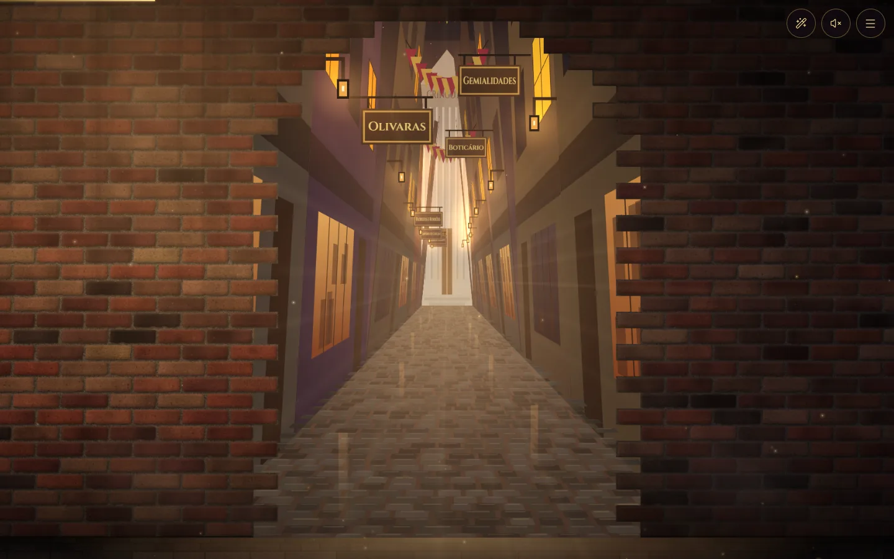
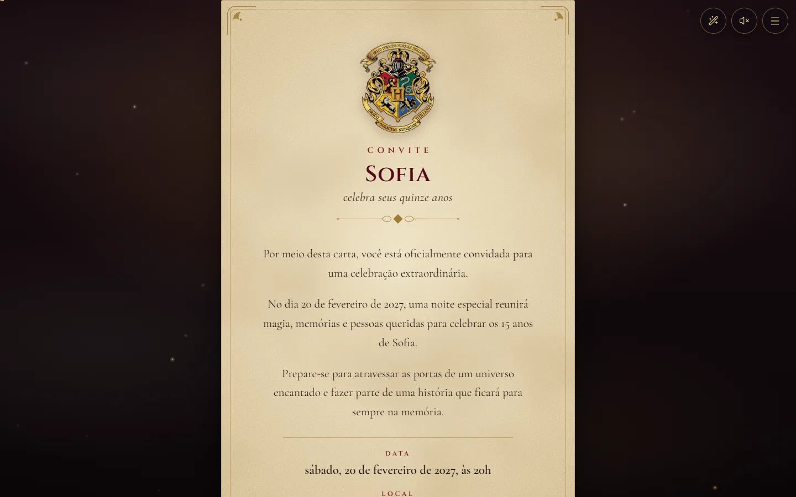
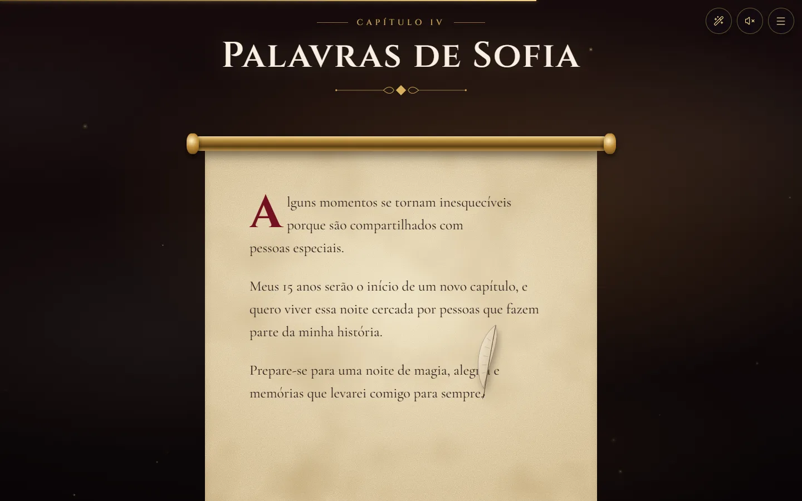
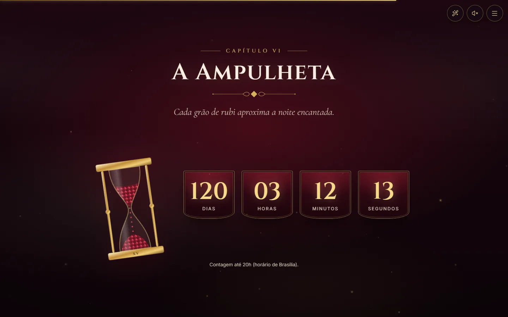
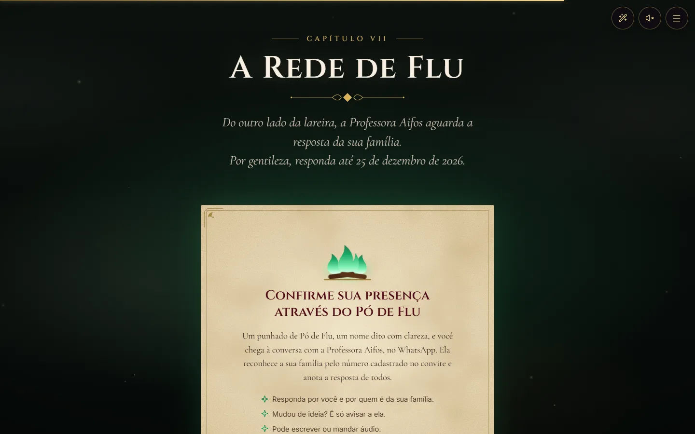
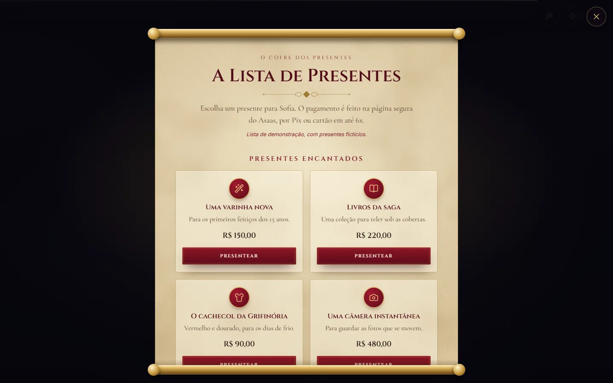
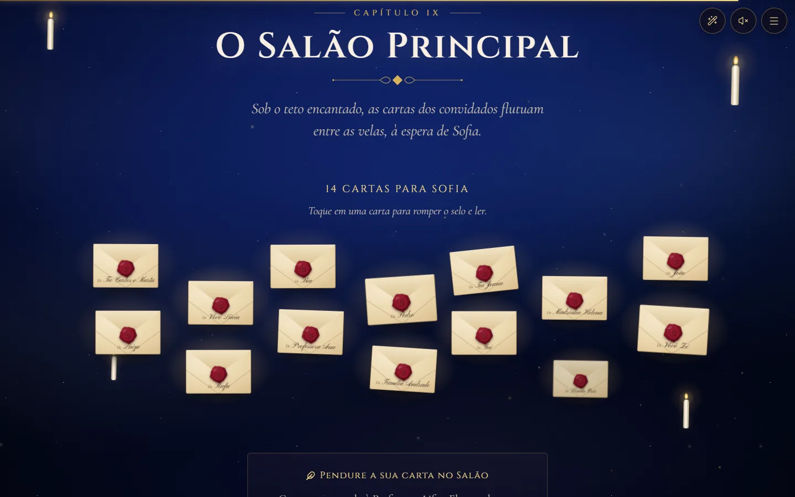
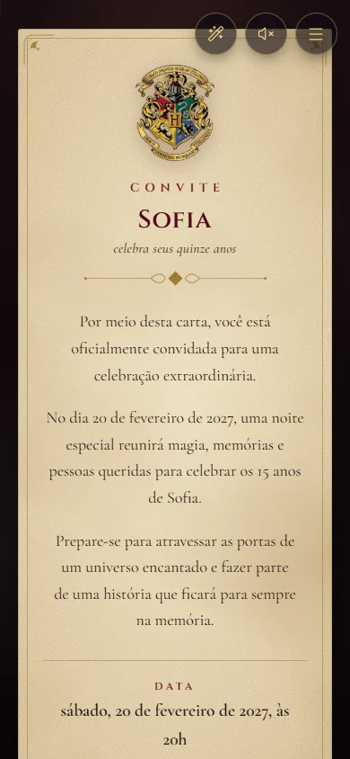
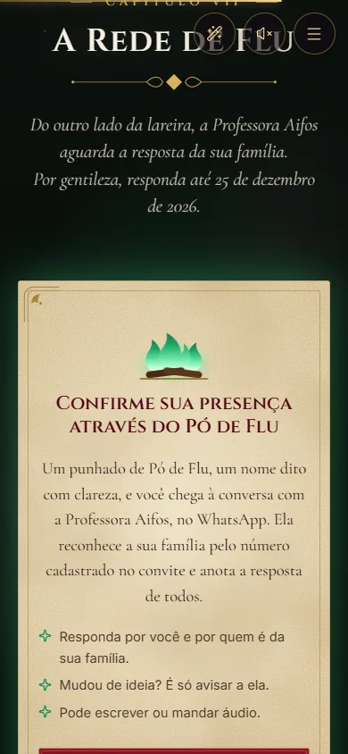
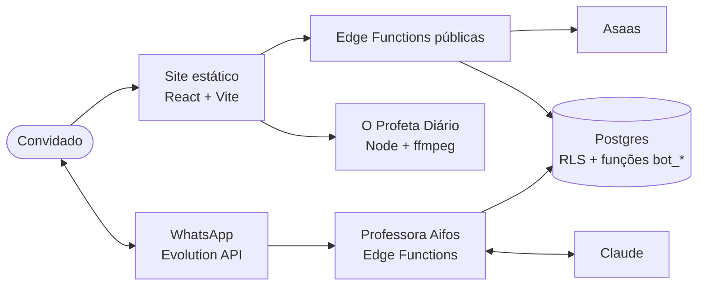

# Convite de 15 anos · Uma jornada mágica

Convite digital imersivo com tema Harry Potter. Uma carta selada se abre e conduz o convidado por
dez capítulos animados, da parede de tijolos do Beco Diagonal ao Salão Principal. A confirmação de
presença fica com a **Professora Aifos**, uma agente de IA no WhatsApp que reconhece cada família da
lista de convidados e anota a resposta de todos.

<p align="center">
  
  
</p>

## Capítulos

| | |
| --- | --- |
|  |  |
| **A Carta**: o convite em pergaminho | **II · A Casa da Coragem** |
|  |  |
| **III · Retratos que se Movem**: torre espiral guiada pela rolagem | **IV · Palavras da aniversariante**, escritas por uma pena |
|  |  |
| **V · O Mapa da Celebração**: data, local, agenda e mapa | **VI · A Ampulheta**: contagem regressiva |
|  |  |
| **VII · A Rede de Flu**: leva à Professora Aifos no WhatsApp | **VIII · O Cofre dos Presentes**: cotas, vaquinhas e Pix |
|  |  |
| **IX · O Salão Principal**: recados flutuam como cartas | **X · Até Breve** |

No celular:

<p align="center">
  
  
  
</p>

> As capturas usam dados de demonstração. As fotos da galeria são retratos de exemplo: fotos de
> pessoas, a lista de convidados e a música não fazem parte do repositório.

## Destaques

- **Narrativa cinematográfica com GSAP:**
  - envelope que rompe o selo;
  - parede de tijolos que se abre em 3D (Canvas + ScrollTrigger);
  - torre espiral de retratos;
  - texto escrito por uma pena;
  - iluminação que muda de cor a cada capítulo.
- **Agente de IA no WhatsApp:**
  - a Professora Aifos (Claude + Supabase Edge Functions) confirma a presença por família;
  - entende áudio, lembra das conversas anteriores, guarda recados e retoma conversas paradas;
  - avisa os organizadores, que têm comandos próprios.
- **Regras críticas no código, não no prompt:**
  - quem pode responder por quem é decidido no banco;
  - os detalhes da festa só chegam a quem está na lista;
  - nenhuma confirmação é dada antes de o banco aceitar a gravação.
- **Lista de presentes com pagamento real:**
  - checkout do Asaas por Pix ou cartão em até 6x;
  - o preço é recalculado no servidor, com limite de tentativas e webhook autenticado.
- **O Profeta Diário:** mural de fotos e vídeos da festa, protegido por uma palavra mágica, com
  processamento por ffmpeg e moderação pelo WhatsApp.
- **Acessibilidade e desempenho:**
  - movimento reduzido respeitado em todo o site e navegação completa por teclado;
  - `<dialog>` nativos;
  - capítulos carregados sob demanda e loops pausados fora da tela;
  - imagens em AVIF/WebP.

## Arquitetura



O site é estático e não guarda nada no navegador. Todo o estado mora no Postgres do Supabase, sem
nenhum acesso público às tabelas: só as Edge Functions, com `service_role`, chamam as funções do
banco. Detalhes de cada parte em **[docs/arquitetura.md](docs/arquitetura.md)**, e o esquema completo
do banco (tabelas, funções, gatilhos, RLS e permissões) em **[supabase/schema.sql](supabase/schema.sql)**.

## Stack

| Camada | Tecnologias |
| --- | --- |
| Site | React 19, TypeScript (estrito), Vite 8, GSAP 3 (ScrollTrigger), Tailwind CSS 4, Canvas 2D |
| Agente | Claude Haiku (Anthropic SDK), Supabase Edge Functions (Deno), Evolution API (WhatsApp) |
| Banco | Postgres (Supabase), RLS, pg_cron, pg_net, Vault, pg_trgm e fuzzystrmatch |
| Pagamentos | Asaas (checkout hospedado, webhook) |
| Mídia | Node 24 (sem dependências), ffmpeg, sharp |
| Infra | VPS com Traefik e Nginx (Portainer), deploy por SSH com versões e retorno rápido |
| Testes | Vitest, PGlite (Postgres embutido), playwright-core + Chrome, avaliação do agente com o modelo real |

## Estrutura

```
src/
  content/        todo o conteúdo editável (data, local, textos, presentes, fotos, SEO)
  sections/       um componente por capítulo, com a própria coreografia GSAP
  animations/     registro do GSAP, abertura, iluminação por cena
  lib/            lógica pura e testada (Pix, calendário, contagem, preços)
  profeta/        página d'O Profeta Diário
supabase/
  migrations/     banco (fonte de verdade)
  schema.sql      esquema final gerado (npm run db:schema)
  functions/      Edge Functions: Aifos, lista de presentes, Salão Principal
services/profeta/ serviço de fotos e vídeos
scripts/          e2e, imagens, simulador e avaliação da Aifos, deploy
tests/            Vitest, inclusive as migrações SQL em PGlite
deploy/vps/       Nginx e stack do Profeta
```

## Rodar localmente

Requisitos: Node.js 20.19 ou mais recente e npm.

```bash
npm install
npm run dev            # http://localhost:5173
```

O site roda sem nenhuma credencial. Para ver as partes que dependem do servidor com dados de
demonstração, use `?presentes=demo` (lista de presentes) e `?salao=aberto` (Salão Principal).

| Comando | O que faz |
| --- | --- |
| `npm run build` | Typecheck + build de produção em `dist/` |
| `npm run validate` | Lint, testes, build e varredura de segredos no `dist/` |
| `npm run test:e2e` | Verificações no Chrome sobre o build de produção |
| `npm run agent:chat` | Conversa com a Aifos no terminal (precisa de `ANTHROPIC_API_KEY`; banco local com convidados fictícios) |
| `npm run agent:eval` | Avaliação da Aifos em 40 cenários |
| `npm run db:schema` | Regenera `supabase/schema.sql` |

Para publicar o agente e o banco: copie `supabase/functions/.env.example`, aplique as migrações com
`npx supabase db push` e publique as funções com `npx supabase functions deploy`.

## Qualidade

- **379 testes** (Vitest) cobrindo a lógica do site, o agente e suas ferramentas, o canal do WhatsApp,
  a lista de presentes, o Profeta e as **migrações SQL**. As migrações rodam num Postgres embutido, e
  um teste confere, com o papel `anon`, que nenhuma tabela ou função fica exposta.
- **Testes de ponta a ponta** no Chrome sobre o build de produção: abertura, navegação, teclado,
  movimento reduzido e ausência de rolagem horizontal no celular.
- **Avaliação do agente** com o modelo real em 40 cenários, incluindo injeção de prompt, números fora
  da lista, menores tentando responder pela família e perguntas sobre presentes.
- **Varredura de segredos** no bundle a cada build.

## Privacidade

O repositório não contém dados pessoais:
- a lista de convidados, os telefones, as fotos, os recados e as conversas ficam só no banco e na
  máquina de quem publica;
- os testes usam apenas pessoas fictícias;
- a chave Pix e os segredos são configuração de publicação.

## Feito com Claude Code

Este projeto foi desenvolvido com o [Claude Code](https://claude.com/claude-code), em parceria
entre o autor e a IA: arquitetura, código, testes, revisão de segurança e documentação. O
[CLAUDE.md](CLAUDE.md) é o guia que o Claude Code segue no projeto, com comandos, convenções e regras.

## Aviso

Projeto pessoal de fã, sem fins comerciais. Harry Potter, Hogwarts e nomes relacionados são marcas de
seus respectivos titulares. Este projeto não tem vínculo com eles.
