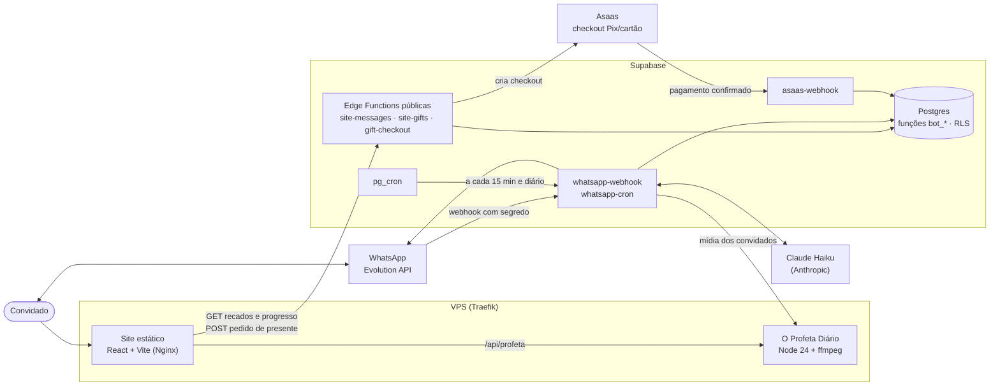

# Arquitetura

Este documento descreve como as partes do convite se encaixam. Para instalar e rodar, veja o
[README](../README.md).

- [Visão geral](#visao-geral)
- [O site](#o-site)
- [Professora Aifos](#professora-aifos)
- [Banco de dados](#banco-de-dados)
- [Lista de presentes](#lista-de-presentes)
- [Recados](#recados)
- [O Salão Principal](#o-salao-principal)
- [O Profeta Diário](#o-profeta-diario)
- [Galeria](#galeria)
- [Hospedagem](#hospedagem)
- [Qualidade](#qualidade)

## Visão geral

O site não tem login nem banco no navegador: é estático e só **leva o convidado até a Aifos**, no
WhatsApp, que é quem confirma a presença. As únicas chamadas do navegador são três funções públicas
do Supabase (duas de leitura e o pedido de presente) e o serviço do Profeta, na mesma origem.

## O site

- **React 19 + Vite + TypeScript estrito**, Tailwind 4 para utilitários e CSS por componente.
- **Um componente por capítulo** em `src/sections/<Capítulo>/`, com a própria coreografia GSAP.
  Os capítulos depois da carta são carregados com `React.lazy` (`src/app/Journey.tsx`).
- **Conteúdo separado do código:** data, local, textos, presentes, Pix e fotos ficam em
  `src/content/`. Campo desconhecido fica `null` e a interface se adapta (aviso "a confirmar",
  botão oculto), em vez de exibir dado inventado.
- **Animações:** sempre por `useGsapScene` (`gsap.context` com `revert`), com `gsap.from` para que o
  estado natural do CSS seja visível se a animação falhar. Com movimento reduzido, tudo aparece
  pronto; o e2e confere que nada fica escondido.
- **Desempenho:** loops (velas, partículas, chamas) só rodam com a cena visível e a aba ativa; a
  parede do Capítulo I é pintada em Canvas uma vez por tamanho de tela.
- **Segurança no navegador:** nenhuma chave no bundle (`npm run check:secrets` varre o `dist/`), CSP
  com `connect-src` limitado às origens usadas e cabeçalhos de segurança no Nginx.

## Professora Aifos

Agente de IA no WhatsApp que recebe os convidados no papel de uma professora de Hogwarts. Código em
`supabase/functions/_shared/agent/` (agente) e `_shared/whatsapp/` (canal).

### Caminho de uma mensagem

1. A **Evolution API** chama `whatsapp-webhook` com um segredo longo (comparado em tempo constante).
2. A mensagem entra na fila `wa_inbox`, idempotente pelo id do WhatsApp, e a função responde 200 na hora.
3. Em segundo plano, uma **trava por contato** garante uma resposta por vez; mensagens seguidas são
   respondidas juntas.
4. Áudios são transcritos antes de chegar ao agente.
5. O agente (Claude Haiku, raciocínio adaptativo) roda um laço de ferramentas, com no máximo 6
   chamadas ao modelo por mensagem, e devolve a resposta em partes curtas, como numa conversa.

### Ferramentas

| Ferramenta | O que faz |
| --- | --- |
| `ver_situacao_da_familia` | Quem é da família do remetente e a resposta de cada um |
| `ver_detalhes_da_festa` | Fatos oficiais da festa (gerados de `src/content/` por `npm run agent:facts`) |
| `registrar_resposta` | Grava presença ou ausência de um ou mais membros da família |
| `buscar_convidado` / `confirmar_identidade` | Identifica pelo nome quem escreve de um número sem cadastro |
| `pedir_confirmacao_da_familia` | Abre um pedido numerado para os organizadores decidirem |
| `guardar_recado` | Guarda um recado para a aniversariante |
| `lembrar` / `guardar_nome_preferido` | Memória entre conversas |
| `reagir` | Reage à mensagem com um emoji |
| `encaminhar_para_familia` | Repassa aos organizadores uma dúvida que só eles resolvem |
| `ver_profeta_diario` | Endereço e palavra mágica do mural de fotos |

### O que é garantido por código, não pelo modelo

O prompt define a persona e o tom; as regras que importam não dependem da IA seguir instruções:

- **Detalhes da festa só para quem está na lista:** a ferramenta de fatos só responde a remetente
  identificado, e os fatos não ficam no prompt.
- **Quem pode responder por quem** é decidido no banco (`bot_set_rsvp`): menores respondem só por si,
  e ninguém mexe na resposta de outra família, por mais que tente convencer o modelo.
- **Nenhum sucesso falso:** a confirmação ao convidado só sai depois que o banco aceitou a gravação.
- **Busca por nome sem vazar a lista:** o primeiro nome precisa ser parecido (Levenshtein), sobrenome
  sozinho não acha ninguém, e no empate o agente só pede o nome completo, sem dizer quantos achou.
- **Organizadores** são reconhecidos pelo telefone e têm comandos respondidos sem IA ("relatório",
  "recados", "presentes", "publicar N", "aceitar N", "fotos"…).

### Rotinas e limites

- `whatsapp-cron` (pg_cron, a cada 15 min): retoma conversas paradas há 3 h, só entre 9h e 21h, e
  reprocessa mensagens esquecidas na fila. Uma vez por dia, manda o relatório aos organizadores.
- Sessões encerram com resumo depois de 12 h de silêncio; os resumos viram memória da próxima conversa.
- Teto de uso por telefone e por dia, controlado no banco.

### Como é avaliada

- `npm run agent:chat`: simulador no terminal, com o modelo real e um Postgres embutido com
  convidados fictícios.
- `npm run agent:eval`: 40 cenários roteirizados (confirmação pela família, menores, número errado,
  injeção de prompt, fora da lista, recados, presentes…), checados pelo estado final do banco, pelas
  ferramentas chamadas e pelo texto. Roda em cerca de 100 s.

## Banco de dados

Postgres do Supabase, definido em `supabase/migrations/` (fonte de verdade). O esquema final legível,
com tabelas, funções, gatilhos, RLS, permissões e agendamentos, está em
[`supabase/schema.sql`](../supabase/schema.sql), gerado por `npm run db:schema`.

| Área | Tabelas |
| --- | --- |
| Lista de convidados | `households`, `guests`, `rsvp_events` (histórico de respostas), `rsvp_settings` |
| Conversas e memória | `wa_contacts`, `wa_inbox`, `wa_sessions`, `wa_session_messages`, `contact_notes`, `bot_usage` |
| Identidade | `identity_requests` (pedidos que os organizadores aceitam ou recusam) |
| Recados e Salão | `guest_messages`, `message_wall_settings` |
| Presentes | `gift_orders`, `gift_webhook_events` |

**Modelo de segurança:**

- RLS ligado em todas as tabelas, sem nenhuma política: `anon` e `authenticated` não leem nem escrevem nada.
- Toda operação passa por funções `bot_*` em `SECURITY DEFINER` com `search_path = ''`, executáveis
  só por `service_role` (as Edge Functions).
- Os testes sobem as migrações num Postgres embutido (PGlite) e conferem, com o papel `anon`, que
  nenhuma tabela ou função fica exposta.
- Segredos do cron ficam no Vault. Os dados de conversa têm uma função de limpeza para depois da
  festa (LGPD), que preserva os recados.

## Lista de presentes

Três tipos de presente, configurados em `src/content/gifts.ts`:

- **Cota:** preço fixo, que vários convidados podem escolher.
- **Vaquinha:** cada um contribui com quanto quiser, e o site mostra o progresso ("R$ X de R$ Y").
- **Sugestão livre:** sem pagamento pelo site.

O pagamento acontece no checkout hospedado do **Asaas**, por Pix ou cartão:

- `gift-checkout` **recalcula o preço no servidor**, a partir de uma cópia gerada do catálogo e da
  mesma fórmula de taxas do site (`src/lib/giftPricing.ts`). Nenhum valor vindo do navegador é aceito.
- Exige a origem do convite, limita tentativas por IP (guardado só como HMAC com sal secreto) e por
  dia, e tem campo-isca contra robôs.
- `asaas-webhook` autentica pelo token do painel, ignora eventos repetidos e marca o pedido como pago.
- Pedidos não pagos são apagados em 48 h. O nome de quem pagou só chega aos organizadores, pelo
  WhatsApp, e nunca aparece no site.

## Recados

A Aifos guarda um recado por pessoa para a aniversariante, assinado. Quem responde pela família pode
deixar o recado de um membro ou o "da família toda". Os organizadores leem tudo com o comando
"recados", e `npm run messages:book` gera o **Livro de Recados** em HTML e PDF.

## O Salão Principal

Capítulo IX do site: os recados aprovados pelos organizadores ("publicar N" no WhatsApp) flutuam como
cartas sob um teto estrelado. Até o dia da festa as cartas ficam **seladas**: a função pública
`site-messages` devolve só o remetente, e o texto nem sai do banco antes de
`message_wall_settings.unseal_at`. Se o autor troca o texto, o recado volta para a fila de aprovação.

## O Profeta Diário

Mural de fotos e vídeos dos convidados durante a festa, em `/profeta/` (segunda entrada do Vite).

- **Acesso** pela palavra mágica impressa nos cartões das mesas, que vira um cookie de sessão assinado
  (HMAC, `HttpOnly`, `Secure`), com limite de tentativas por IP.
- **Serviço próprio** em `services/profeta/`: Node 24 rodando TypeScript direto, sem dependências do
  npm, mais ffmpeg, num container sem root e atrás do Traefik, na mesma origem do site.
- **Arquivos** num disco de tamanho fixo, com cota e reserva de espaço, para não afetar outros
  serviços da VPS.
- **Tipo conferido pela assinatura do arquivo**, nunca pela extensão.
- **Metadados removidos** (inclusive GPS): foto reduzida a 2560 px e vídeo cortado em 15 s, em 720p.
- Fotos e vídeos mandados à Aifos por convidados da lista vão ao mural **sem passar pela IA**.
- A moderação é feita pelo WhatsApp ("fotos", "retirar foto N", "devolver foto N").

## Galeria

Capítulo III: uma torre espiral de retratos guiada pela rolagem.

- O palco é `position: sticky` (sem pin) e a geometria fica em funções puras e testadas (`spiral.ts`).
- O canvas atrás dos quadros desenha a fita de luz e as partículas.
- O quadro da frente abre um `<dialog>` nativo para ampliar a foto.
- Sem JavaScript ou com movimento reduzido, a torre vira uma coluna estática.

As fotos deste repositório são **retratos de exemplo**: as fotos reais nunca são versionadas.

## Hospedagem

- **Site:** `npm run deploy:vps` faz o build e envia o `dist/` por SSH para a VPS.
  - Cada versão vai para uma pasta em `releases/`, e um link `current` é trocado de uma vez.
  - `--voltar` desfaz a última troca.
  - O Nginx (`deploy/vps/nginx.conf`) aplica cache por caminho e os cabeçalhos de segurança.
- **O Profeta Diário:** `npm run deploy:profeta` constrói a imagem na VPS. O modelo da stack está em
  `deploy/vps/profeta.stack.yml`.
- **Supabase:**
  - `npx supabase db push` aplica as migrações;
  - `npx supabase functions deploy …` publica as Edge Functions;
  - os segredos seguem `supabase/functions/.env.example`.

## Qualidade

| Comando | Cobertura |
| --- | --- |
| `npm run validate` | ESLint, 379 testes (Vitest), build com TypeScript estrito e varredura de segredos no `dist/` |
| `npm test` | Lógica do site, agente e ferramentas, WhatsApp, presentes, Profeta e as migrações SQL em PGlite (inclusive o acesso do papel `anon`) |
| `npm run test:e2e` | Verificações no Chrome sobre o build de produção: abertura, navegação, acessibilidade, movimento reduzido e ausência de rolagem horizontal no celular |
| `npm run agent:eval` | Comportamento da Aifos com o modelo real, em 40 cenários |
